<h1 align="center">WhisperWriter AMD</h1>

<p align="center">
  <b>Local, GPU-accelerated speech-to-text for Windows.</b><br>
  Press a hotkey, talk, and the text appears in whatever window you are typing in.<br>
  Built for <b>AMD Radeon GPUs</b> and for dictating prompts into <b>Claude Code</b>.
</p>

<p align="center">
  
  
  
  
  
</p>

<p align="center">
  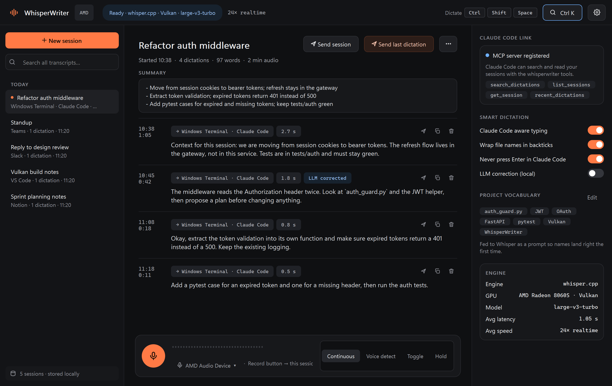
</p>

---

## Highlights

- **Fast on AMD.** Whisper runs on your Radeon GPU or iGPU through
  [whisper.cpp](https://github.com/ggml-org/whisper.cpp) + Vulkan. On a Radeon 8060S,
  `large-v3-turbo` turns 11 s of speech into text in about 0.5 s, roughly **24× realtime**.
- **Types anywhere.** The text goes into the focused window: terminal, editor, browser, chat.
- **Remembers everything.** Every dictation is saved in a searchable local history, grouped
  into sessions.
- **Built for Claude Code.** It detects Claude Code in your terminal, never sends the prompt
  for you, wraps file names in backticks, sends whole sessions to Claude Code as context, and
  lets Claude Code read your dictation history through an MCP server.
- **Summaries.** A local LLM can boil a session down to decisions, tasks and open questions.
- **Handles noisy rooms.** Strict voice detection and a hallucination filter keep keyboard
  clicks, fans and silence from becoming made-up text.
- **Private.** Everything runs on your machine. No cloud, no account, no telemetry.

## Contents

1. [How it works](#how-it-works)
2. [Installation](#installation)
3. [Your first dictation](#your-first-dictation)
4. [A tour of the app](#a-tour-of-the-app)
5. [Using WhisperWriter with Claude Code](#using-whisperwriter-with-claude-code)
6. [Sessions, search and history](#sessions-search-and-history)
7. [Light or dark](#light-or-dark)
8. [Getting names and jargon right](#getting-names-and-jargon-right)
9. [Settings reference](#settings-reference)
10. [Troubleshooting](#troubleshooting)
11. [For developers](#for-developers)
12. [Credits and license](#credits-and-license)

## How it works

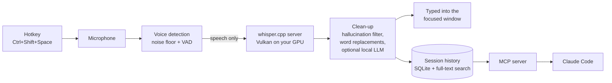

1. You press the hotkey. A small pill at the bottom of the screen shows that it is listening.
2. Voice detection waits for real speech, so clicks, fans and silence are ignored. When you
   pause, the recording ends.
3. The audio goes to a local **whisper.cpp** server running on your GPU. The model stays
   loaded, so every dictation costs only inference time.
4. The text is cleaned up, typed into the window you were in, and saved to the current session.
5. Claude Code can later search those sessions through the built-in MCP server.

## Installation

There are two ways to install: the **portable download** (no Python, no build) or
**from source** (all options, including the CPU-only faster-whisper engine).

### Quick install: portable download

1. Download `WhisperWriter-AMD-<version>-win64.zip` from the
   [latest release](https://github.com/storm-ace/WhisperWriter-AMD/releases/latest) and unzip
   it anywhere, for example to `C:\Programs\WhisperWriter`.
2. Start `WhisperWriter.exe`. On the first start it downloads the `large-v3-turbo` model
   (1.6 GB) into its `models` folder by itself; the status pill shows the progress. To use a
   different model, drop another `ggml-*.bin` into `models` (`models\README.txt` lists the
   options). The bundled whisper.cpp server (built with Vulkan) and the model are picked up
   automatically. The engine card in Settings shows which GPU it
   uses; without a Vulkan GPU it falls back to the CPU.

Settings and history are stored in `%APPDATA%\WhisperWriter`, so you can replace the program
folder with a newer release without losing anything. **Settings → Claude Code → Add to Claude
Code** registers the bundled `whisperwriter-mcp.exe`. The portable build does not include the
faster-whisper engine; install from source if you need it.

The rest of this section installs from source.

### What you need

| | Requirement |
| --- | --- |
| OS | Windows 10 or 11 |
| Python | **3.11** (3.12 and newer are not supported by the pinned dependencies) |
| Git | [git-scm.com](https://git-scm.com/downloads) |
| GPU (recommended) | Any Vulkan-capable GPU: AMD Radeon (discrete or iGPU), Intel Arc, NVIDIA |
| Disk | about 2 GB for the app plus a model (`large-v3-turbo` is 1.6 GB) |

> **No GPU?** WhisperWriter also runs on the CPU with the built-in `faster-whisper` engine.
> Skip [step 3](#step-3--build-whispercpp-with-vulkan-amd-gpu) and pick *faster-whisper* in
> step 4.

### Step 1 — Get the code

```bash
git clone https://github.com/storm-ace/WhisperWriter-AMD
cd WhisperWriter-AMD
```

### Step 2 — Create a Python environment and install the dependencies

```bash
py -3.11 -m venv .venv
.venv\Scripts\activate
pip install -r requirements.txt "setuptools<81"
```

`setuptools<81` is needed because `ctranslate2` (used by the CPU engine) still imports
`pkg_resources`.

### Step 3 — Build whisper.cpp with Vulkan (AMD GPU)

The stock `faster-whisper` engine only supports CPU and NVIDIA CUDA, so AMD GPUs would sit
idle. WhisperWriter instead runs Whisper through a local `whisper-server` built with Vulkan.
whisper.cpp does not publish a ready-made Vulkan build for Windows, so you build it once.
It takes about five minutes.

**3a. Install the build tools.** Run this in any terminal; accept the UAC prompts:

```bash
winget install -e --id KhronosGroup.VulkanSDK
winget install -e --id Kitware.CMake
winget install -e --id BrechtSanders.WinLibs.POSIX.UCRT
```

These install the Vulkan SDK (`C:\VulkanSDK`), CMake, and the MinGW-w64 C++ compiler. Open a
**new** terminal afterwards so the tools are on your `PATH`.

**3b. Build the server:**

```bash
git clone --depth 1 --branch v1.9.5 https://github.com/ggml-org/whisper.cpp C:\tools\whisper.cpp
cd C:\tools\whisper.cpp
cmake -B build -G "MinGW Makefiles" -DGGML_VULKAN=ON -DCMAKE_BUILD_TYPE=Release -DWHISPER_SDL2=OFF
cmake --build build -j --target whisper-server
```

The result is `C:\tools\whisper.cpp\build\bin\whisper-server.exe`. You can also build with
Visual Studio: leave out `-G "MinGW Makefiles"`. Use whisper.cpp **v1.8.1 or newer**; older
versions do not detect AMD iGPUs over Vulkan.

**3c. Download a model** (ggml format, not the faster-whisper format):

```bash
curl -L -o C:\tools\whisper.cpp\models\ggml-large-v3-turbo.bin https://huggingface.co/ggerganov/whisper.cpp/resolve/main/ggml-large-v3-turbo.bin
```

| Model | Size | Notes |
| --- | --- | --- |
| `ggml-large-v3-turbo.bin` | 1.6 GB | **Recommended.** Fast and accurate. |
| `ggml-large-v3.bin` | 3.1 GB | Most accurate, about half the speed. |
| `ggml-small.bin` | 466 MB | For weak iGPUs or low memory. |

**3d. Optional: check that the GPU is used.** Start the server once by hand:

```bash
C:\tools\whisper.cpp\build\bin\whisper-server.exe -m C:\tools\whisper.cpp\models\ggml-large-v3-turbo.bin
```

The log should contain `ggml_vulkan: 0 = AMD Radeon ...` and `using Vulkan0 backend`. Stop it
with `Ctrl+C`; from now on WhisperWriter starts and stops it for you.

### Step 4 — First launch and engine setup

```bash
python run.py
```

On the first launch WhisperWriter opens on **Settings → Engine & GPU**:

<p align="center">
  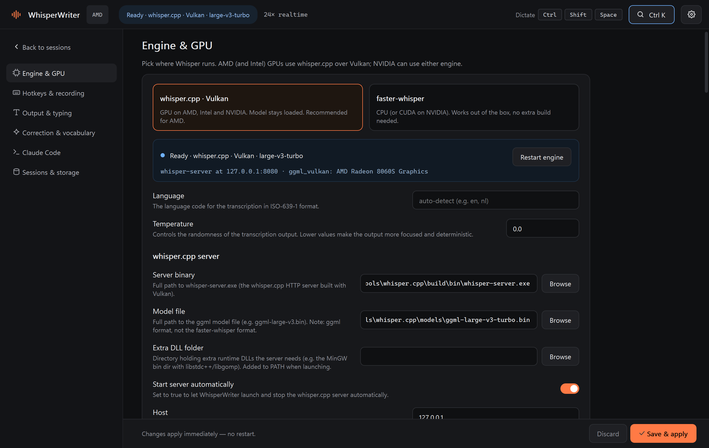
</p>

1. Click **whisper.cpp · Vulkan**, or *faster-whisper* if you have no GPU.
2. Set **Server binary** to your `whisper-server.exe` and **Model file** to the `.bin` model.
3. **Extra DLL folder**: if the server fails to start with a MinGW build, point this at the
   MinGW `bin` folder (`%LOCALAPPDATA%\Microsoft\WinGet\Packages\BrechtSanders.WinLibs...\mingw64\bin`).
4. Click **Save & apply**.

The status pill in the top bar changes to **Ready · whisper.cpp · Vulkan · large-v3-turbo**,
and the engine card shows the GPU the server picked (for example
`AMD Radeon(TM) 8060S Graphics`). If the card says *no GPU found*, whisper.cpp was built
without Vulkan. That is the whole setup.

### Step 5 — Start with Windows (optional)

| File | What it does |
| --- | --- |
| `start.bat` | Starts WhisperWriter with a console window, which is useful for logs |
| `start_hidden.vbs` | Starts WhisperWriter with no console; it lives in the system tray |
| `create_shortcut.ps1` | Creates Desktop and Start menu shortcuts (with the WhisperWriter icon). Add `-Autostart` for a login shortcut; with **Start in tray at login** on, that one starts in the tray. |

Closing the window keeps WhisperWriter running in the **system tray**. Quit from the tray
menu, which also stops the GPU server. Starting it a second time brings the running window
back instead of opening a second copy.

More Windows details (NVIDIA/CUDA, common pip problems) are in [INSTALL.md](INSTALL.md).

## Your first dictation

1. Click into any text field: Notepad, a terminal, a chat box.
2. Press **`Ctrl+Shift+Space`** and start talking.
3. The recorder pill appears at the bottom of your screen:

| Listening | Transcribing | Done |
| :---: | :---: | :---: |
|  | 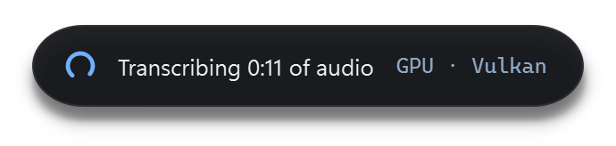 | 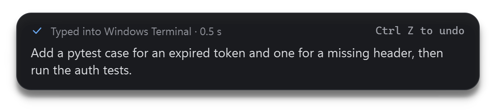 |
| Timer, live waveform and the window the text will go to. **■** stops, **✕** cancels. | The audio is being transcribed on your GPU. | The text was typed into your window. `Ctrl+Z` undoes it in most apps. |

4. Stop talking. After a short pause (1.2 s by default) the text appears where your cursor is.

The pill never takes keyboard focus, so the text always lands in the window you were in.

### Recording modes

Switch the mode in the record dock at the bottom of the main window:

| Mode | How it behaves | Good for |
| --- | --- | --- |
| **Continuous** (default) | Types after each pause and keeps listening. The microphone stays open while a sentence is transcribed, so nothing you say in between is lost. Press the hotkey or **■** to stop. | Long dictation sessions |
| **Voice detect** | Records until you pause, types, then stops. | One prompt or message at a time |
| **Toggle** | Press the hotkey once to start and once to stop. | Long thoughts with long pauses |
| **Hold** | Records only while you hold the hotkey. | Push-to-talk |

### Keyboard shortcuts

| Shortcut | Action |
| --- | --- |
| `Ctrl+Shift+Space` | Start or stop dictating, from anywhere (configurable; mouse buttons work too) |
| `Ctrl+K` | Command palette: search sessions and run commands |
| `Ctrl+N` | New session |
| `Ctrl+F` | Search all transcripts |
| `Ctrl+,` | Settings |
| `Esc` | Close the palette or settings, clear the search |

## A tour of the app

<p align="center">
  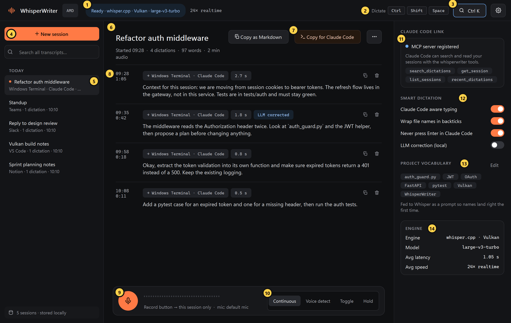
</p>

| # | Element | What it does |
| :-: | --- | --- |
| 1 | **Engine status** | Shows whether the engine is starting, ready or failed, with the model name. Next to it is the measured speed. |
| 2 | **Hotkey** | Your current dictation shortcut. |
| 3 | **Command palette** | `Ctrl+K`: jump to any session by searching its text, or run a command. |
| 4 | **New session** | Starts a fresh session. One also starts automatically after 30 idle minutes. |
| 5 | **Session list** | All sessions grouped by day. The dot marks the session new dictations go to. Right-click for more actions. |
| 6 | **Session title** | Double-click to rename. Below it: start time, number of dictations, words and audio length. |
| 7 | **Send session / Send last dictation** | **Send session** sends the whole session as context to the Claude app or your Claude Code terminal; **Send last dictation** sends only your most recent dictation. **⋯** has copy as context, rename, summarise, export and delete. |
| 8 | **Summary** | The local-LLM summary of the session (decisions, tasks, open questions), once you have made one. |
| 9 | **Dictation** | Time, length, target window, transcription speed, and whether the LLM corrected it. The icons send this one dictation to Claude, copy it, or delete it. |
| 10 | **Record button** | Dictates into this session only, without typing anywhere. Click again to stop. |
| 11 | **Recording mode** | Continuous, Voice detect, Toggle or Hold. |
| 12 | **Claude Code link** | Shows whether the MCP server is registered, so Claude Code can read your history. |
| 13 | **Smart dictation** | Quick switches for Claude Code-aware typing, backticks, the Enter key and LLM correction. |
| 14 | **Project vocabulary** | Names and terms Whisper should always spell right. |
| 15 | **Engine stats** | Engine, the GPU the server is running on, model, average latency and speed. |

## Using WhisperWriter with Claude Code

### Dictating prompts

Leave **Claude Code aware typing** on (the default). When the focused window is a terminal or
editor running Claude Code, WhisperWriter:

- **never presses Enter**, so you can read the prompt before you send it;
- **wraps file names in backticks**: *"open auth_guard.py"* becomes ``open `auth_guard.py` ``;
- labels the dictation `Windows Terminal · Claude Code` in your history.

Both the **Claude desktop app** (its Code tab) and **Claude Code in a terminal** count. A
terminal is recognised by Claude Code's window title (`✳ <task>`, a spinner, or "Claude Code")
while a Claude process is running. Other terminals are left alone.

Typical flow: put your cursor in the Claude Code prompt, press the hotkey, explain the task,
check the text, press Enter yourself.

### Sending dictations to Claude

The session header has two buttons (both also in the palette and the **⋯** menu):

| Button | Sends |
| --- | --- |
| **Send last dictation** | Only your most recent dictation, as plain text. Use it to send what you just said. |
| **Send session** | The whole session as a `<dictation-session>` context block, including its summary. Use it to give Claude the full background. |

Each dictation also has its own send icon. WhisperWriter finds the Claude window you used most
recently (the desktop app or a Claude Code terminal), brings it to the front, pastes the text
and presses Enter, so Claude gets it right away. To add a question before sending, turn off
**Settings → Claude Code → Send buttons submit right away**. If no Claude window is open, the
text is put on your clipboard instead.

### Letting Claude Code read your history (MCP)

Claude Code can search and read everything you dictated, so you never have to repeat
yourself. Set it up once:

<p align="center">
  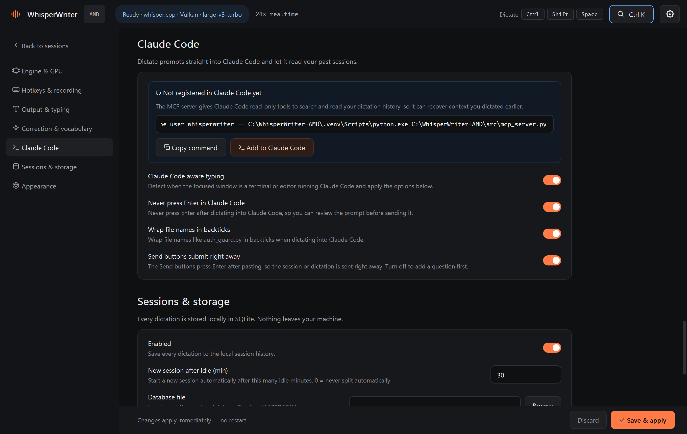
</p>

1. Open **Settings → Claude Code**.
2. Click **Add to Claude Code**. This runs `claude mcp add` for you. If the `claude` CLI is
   not on your `PATH`, click **Copy command** and run it in a terminal instead:

   ```bash
   claude mcp add --scope user whisperwriter -- C:\WhisperWriter-AMD\.venv\Scripts\python.exe C:\WhisperWriter-AMD\src\mcp_server.py
   ```

3. Start a new Claude Code session. Run `claude mcp list` to check that `whisperwriter` is listed.

Claude Code now has these read-only tools:

| Tool | What it does |
| --- | --- |
| `search_dictations` | Full-text search over every dictation |
| `list_sessions` | Recent sessions with id, title, time and size |
| `get_session` | The full transcript of one session, with its summary (default: the latest) |
| `recent_dictations` | The latest dictations, optionally only the last N minutes |

Things you can ask Claude Code:

> *"Check my dictations from this morning about the auth refactor and continue from there."*
>
> *"Search my dictation history for what I said about the token refresh flow."*
>
> *"Read my latest dictation session and turn it into a task list."*

The MCP server uses only the Python standard library, opens the database **read-only**, and
works while the app is running.

## Sessions, search and history

| Search in the sidebar | Command palette (`Ctrl+K`) |
| :---: | :---: |
| 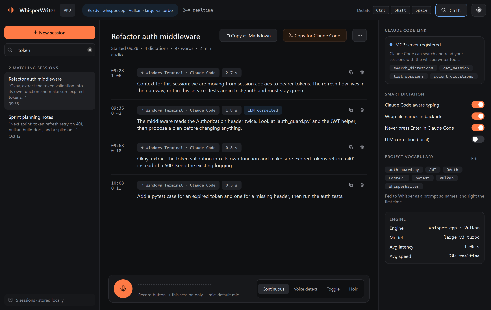 | 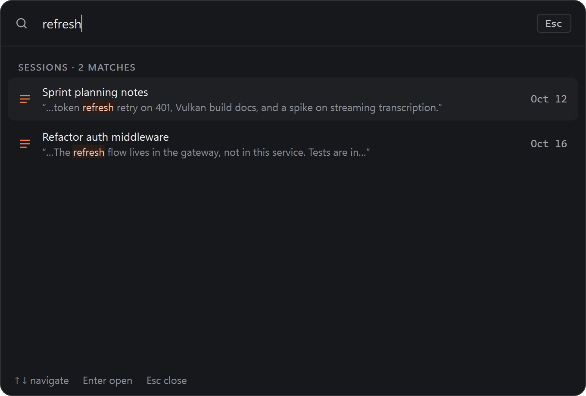 |

- Every dictation is saved with its text, the raw engine output, the target app, the audio
  length and the transcription time.
- Sessions split automatically after **30 idle minutes** (configurable), or when you click
  **New session**. To add to an older session, open it and click **Continue here**.
- Search is full-text and prefix-based: `refr tok` finds *"refresh flow … bearer tokens"*.
- Right-click a session (or use **⋯**) to **rename** it, **summarise it with the local LLM**,
  **send it to Claude Code**, **copy it as context or Markdown**, **export a `.md` file**, or
  **delete** it.
- **Summaries** need the local LLM from
  [Getting names and jargon right](#getting-names-and-jargon-right). The summary is saved with
  the session, shown above its dictations, and included when you send or export it.
- The history lives in `%APPDATA%\WhisperWriter\sessions.db`, a single SQLite file. Back it up
  by copying it. To stop saving history, turn off **Settings → Sessions & storage → Enabled**.

## Light or dark

<p align="center">
  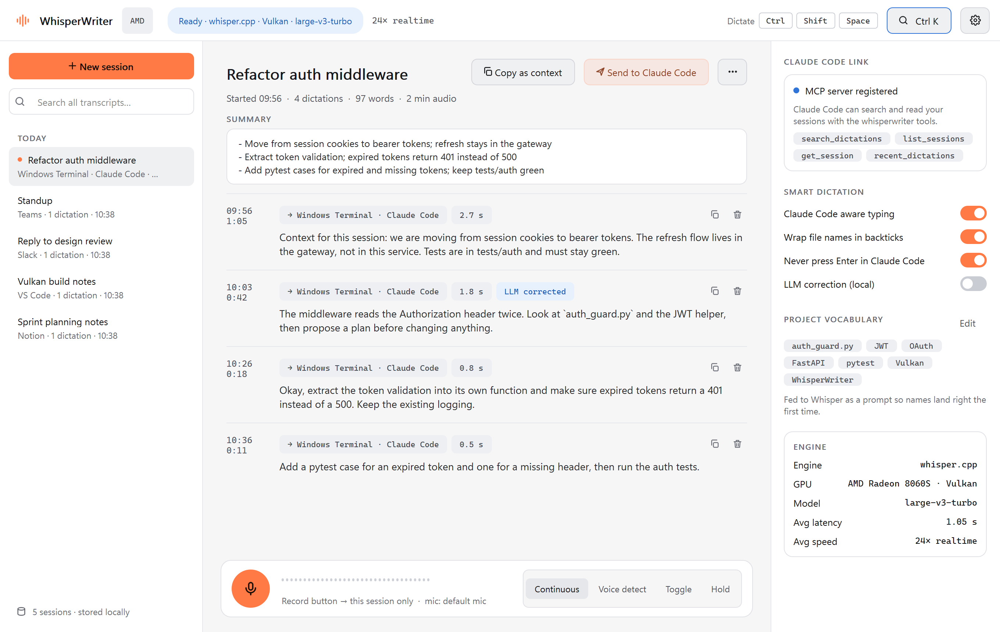
</p>

**Settings → Appearance** switches between a dark and a light theme, or follows Windows
(**System**), and offers four accent colours. The change applies as soon as you save.

<p align="center">
  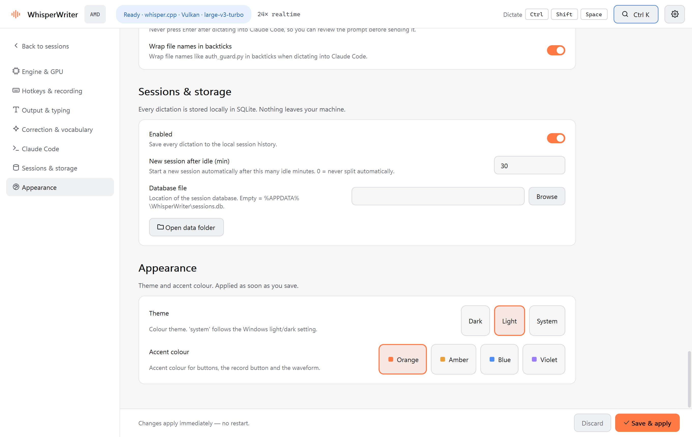
</p>

## Getting names and jargon right

<p align="center">
  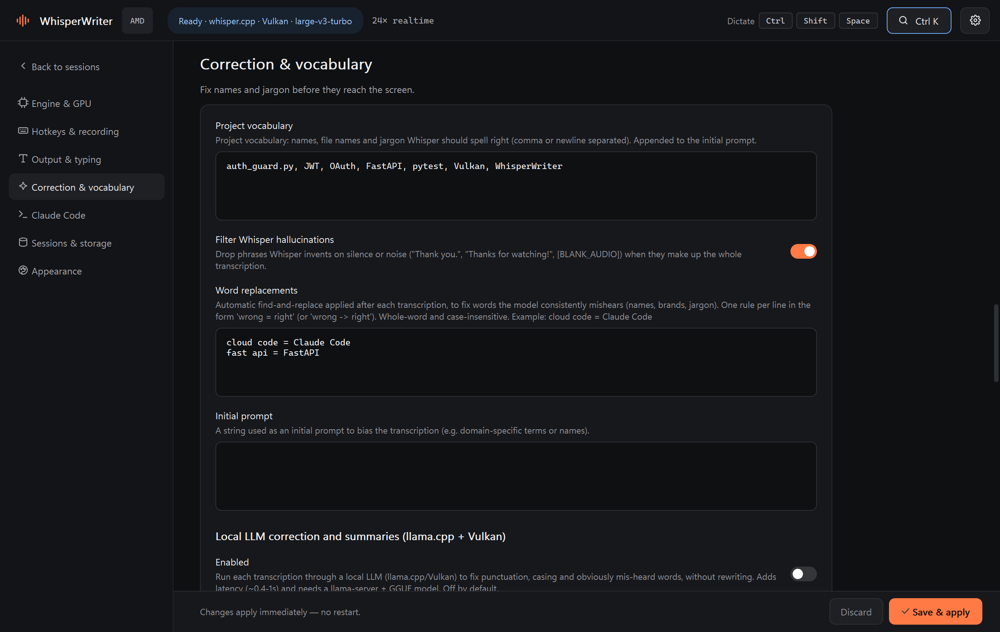
</p>

Three tools, from cheapest to most powerful:

1. **Project vocabulary.** List names, file names and jargon, separated by commas (for example
   `auth_guard.py, FastAPI, pytest`). They are added to Whisper's prompt so they are spelled
   right the first time. There is no speed cost.
2. **Word replacements.** Fixed `wrong = right` rules, one per line, for words the model keeps
   getting wrong (`cloud code = Claude Code`). There is no speed cost.
3. **LLM correction and summaries** (off by default). Each dictation goes through a small local LLM
   ([llama.cpp](https://github.com/ggml-org/llama.cpp) on the same GPU), which fixes
   punctuation, capitals and clear mistakes without rewriting. It adds about 0.4–1 s. Build
   llama.cpp like whisper.cpp (`-DGGML_VULKAN=ON`), download a GGUF model, and set the paths
   here. In testing, *Gemma-3-4B-it Q4_K_M* worked best. If the LLM fails or is too slow, the
   original text is used.

The **hallucination filter** (on by default) drops text Whisper tends to invent on silence or
noise, such as *"Thank you."*, *"Thanks for watching!"* or `[BLANK_AUDIO]`.

## Settings reference

Everything can be changed in the app. **Save & apply** takes effect right away; only the
engine restarts, and only when its own settings changed. Settings are stored in
`src/config.yaml`. [`config.yaml.example`](config.yaml.example) is an annotated example, and
[`src/config_schema.yaml`](src/config_schema.yaml) lists every option with its default and
description.

| Section | Settings |
| --- | --- |
| **Engine & GPU** | Engine (whisper.cpp / faster-whisper), language, temperature, server binary, model file, DLL folder, host and port, CPU threads |
| **Hotkeys & recording** | Dictate hotkey, dictate-without-Enter hotkey, recording mode, microphone, silence before stop, minimum speech, noise rejection (0–3), sample rate |
| **Output & typing** | Insert method (`clipboard` is the most reliable), press Enter after dictating, trailing space and period, beep, hide the recorder pill, start in tray |
| **Correction & vocabulary** | Project vocabulary, hallucination filter, word replacements, initial prompt, local LLM for correction and summaries |
| **Claude Code** | Claude Code aware typing, never press Enter in Claude Code, backtick file names, MCP setup |
| **Sessions & storage** | Save history, new session after N idle minutes, database location |
| **Appearance** | Theme (dark, light, system) and accent colour |

## Troubleshooting

| Problem | Solution |
| --- | --- |
| Status shows **whisper.cpp server not running** | Check **Server binary** and **Model file**. With a MinGW build, set **Extra DLL folder** to MinGW's `bin`. Then click **Restart engine**. |
| The engine card says **no GPU found** | whisper.cpp was built without Vulkan, or the driver is too old. Rebuild with `-DGGML_VULKAN=ON`, update the AMD driver, and use whisper.cpp v1.8.1 or newer. The full server log is in `%APPDATA%\WhisperWriter\whisper-server.log`. |
| **Summary failed: no local LLM server is running** | Set up llama.cpp under **Settings → Correction & vocabulary** and enable LLM correction. |
| **Send session** / **Send last dictation** only copies to the clipboard | No Claude window was found: open the Claude desktop app, or a terminal whose title shows Claude Code's `✳` marker or "Claude Code". Paste with `Ctrl+V`. |
| Words appear that you never said | Raise **Noise rejection** to 3, raise **Minimum speech**, and keep the **hallucination filter** on. |
| Continuous mode cuts sentences in half | Raise **Silence before stop** (for example to 1500 ms). |
| Characters go missing while typing | Set **Insert text with** to `clipboard`. |
| The hotkey does nothing | Another app may own the shortcut. Choose another combo or a mouse button (`mouse_forward`). |
| Claude Code does not show the whisperwriter tools | Start a new Claude Code session after registering, and check `claude mcp list`. |
| Nothing happens when starting the app again | That is by design: it shows the running instance. Look for the tray icon. |

Problems with this fork (AMD engine, UI, sessions, MCP) go to
[the issue tracker](https://github.com/storm-ace/WhisperWriter-AMD/issues/new).

## For developers

```text
run.py                    entry point (loads .env, starts src/main.py)
src/main.py               app wiring: lifecycle, tray, sessions, settings, background tasks
src/engine.py             starts whisper.cpp / faster-whisper (+ LLM server), detects the GPU
src/recording.py          dictation flow: hotkey/button/pill, typing, Claude Code handling
src/result_thread.py      microphone capture, speech segmentation, transcription worker
src/transcription.py      engines, text clean-up, LLM correction and summaries
src/sessions.py           SQLite + FTS5 session store (no Qt dependency)
src/mcp_server.py         stdio MCP server for Claude Code (standard library only)
src/claude_integration.py MCP registration helpers
src/active_window.py      window detection, Claude Code heuristics, focusing a window
src/ui/                   PySide6 UI: theme, main window, context panel, settings, pill, palette
```

The settings page is generated from `src/config_schema.yaml`: add an option there and it
appears in the UI.

To build the portable release (needs `pip install pyinstaller` in the `.venv` and a whisper.cpp
Vulkan build):

```bash
powershell -ExecutionPolicy Bypass -File packaging\build_release.ps1 -WhisperServer C:\tools\whisper.cpp\build\bin\whisper-server.exe
```

The result is `dist\WhisperWriter-AMD-<version>-win64.zip`. To try the MCP server by hand, run `python src/mcp_server.py` and send it
JSON-RPC lines (`initialize`, `tools/list`, `tools/call`).

## Credits and license

- [savbell/whisper-writer](https://github.com/savbell/whisper-writer): the original
  WhisperWriter this project forks, and all its
  [contributors](https://github.com/savbell/whisper-writer/graphs/contributors).
- [ggml-org/whisper.cpp](https://github.com/ggml-org/whisper.cpp) and
  [llama.cpp](https://github.com/ggml-org/llama.cpp): the Vulkan engines.
- [OpenAI Whisper](https://github.com/openai/whisper) and
  [SYSTRAN/faster-whisper](https://github.com/SYSTRAN/faster-whisper).

Licensed under the **GNU General Public License v3.0**; see [LICENSE](LICENSE). This is a
modified version of savbell/whisper-writer. This fork added the whisper.cpp/Vulkan engine
(June 2026) and the PySide6 UI, session history, Claude Code integration and noise-robust
voice detection (October 2026). The upstream code remains © its respective authors.
